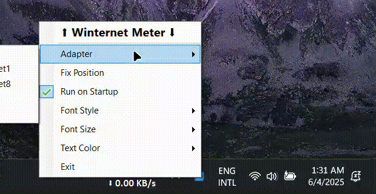

<h1 align="center">🚀 Winternet Meter</h1>

<p align="center">
  Your live upload/download speed in a tiny always-on-top widget — on the taskbar or anywhere you drop it.<br>
  <b>Windows 10/11</b> · <b>Ubuntu / Linux</b> · free and open source (MIT)
</p>

<div align="center">
  
  <br>
  <sub>Sitting on the Windows taskbar next to the clock</sub>
</div>

---

## ⬇️ Download

Get the latest from **[Releases](https://github.com/rakibulx33/WinternetMeter/releases/latest)**.

| System | File | Notes |
|---|---|---|
| Windows 10/11 (most PCs) | `WinternetMeter-<ver>-win-x64-setup.exe` | Installer. No admin needed. |
| Windows on ARM (Snapdragon) | `WinternetMeter-<ver>-win-arm64-setup.exe` | |
| Windows, no install | `WinternetMeter-<ver>-win-x64-portable.exe` | One file, run from anywhere. |
| Ubuntu / Debian | `winternetmeter_<ver>_amd64.deb` | `sudo apt install ./winternetmeter_*.deb` |
| Any Linux | `WinternetMeter-<ver>-x86_64.AppImage` | `chmod +x` and run. |
| GNOME top bar | `winternetmeter@rakibulx33.shell-extension.zip` | See [gnome-extension](gnome-extension/README.md). |

Nothing else to install — .NET is bundled.

> **Windows "protected your PC" warning?** The app isn't code-signed yet. Click **More info → Run anyway**.

---

## ✨ Features

| | |
|---|---|
| 📡 **Right adapter, automatically** | Measures the connection your internet actually goes through. Ignores WSL, Hyper-V, Docker, VirtualBox and VPN adapters (the old version often showed 0 because of these). Follows you from Wi-Fi to Ethernet. |
| 😴 **Survives sleep & network changes** | Keeps working after resume, Wi-Fi switches and VPN connects — no restart needed. |
| 🖼️ **Stays out of your way** | Always on top (even over the taskbar), never steals focus, not in Alt+Tab, hides automatically in fullscreen games/videos. |
| 📏 **Steady display** | Fixed-width numbers — the widget never jumps or resizes. |
| 🔢 **MB/s or Mbps** | Bytes like download managers, or bits like your ISP and speed tests. |
| 🎨 **Customizable** | Font, size, color, transparent or rounded-box background, opacity, update speed. |
| 🖥️ **Multi-monitor & HiDPI aware** | Sharp at any scaling; comes back if you unplug the monitor it was on. |
| 🌗 **Dark mode** | Tray menu follows Windows' light/dark setting. |
| 🪶 **Lightweight** | One small process, one timer. |

Right-click the widget **or** the tray icon for every option.

<div align="center">
  
</div>

---

## 🧭 Using it

- **Move it:** drag with the left mouse button. **Lock position** stops accidental drags.
- **Lost it?** Tray icon → **Reset position**.
- **Start with Windows/Ubuntu:** menu → **Run on startup**.
- **Pick an adapter manually:** menu → **Network adapter**. The menu shows what *Auto* is measuring right now.

### Windows 11: tray icon not visible?
Windows 11 hides new tray icons. Go to **Settings → Personalization → Taskbar → Other system tray icons** and turn on **Winternet Meter**.

### Ubuntu notes
- The tray icon needs the *Ubuntu AppIndicators* extension (on by default in Ubuntu). Other GNOME distros: install "AppIndicator and KStatusNotifierItem Support". Without it, right-click the widget instead.
- Ubuntu uses Wayland. The widget runs through XWayland, where staying on top and remembering its position work on GNOME. If your desktop doesn't keep it on top, use the **GNOME top-bar extension** — it shows the same numbers in the panel.

### Settings file
Plain JSON you can edit or back up:
- Windows: `%AppData%\WinternetMeter\settings.json`
- Linux: `~/.config/winternetmeter/settings.json`

Upgrading from v1 imports your old font, color, size and position automatically.

---

## 🛠️ Build from source

Requires the [.NET 10 SDK](https://dotnet.microsoft.com/download).

```bash
git clone https://github.com/rakibulx33/WinternetMeter.git
cd WinternetMeter
dotnet test tests/WinternetMeter.Core.Tests          # run the tests
dotnet run --project src/WinternetMeter.Windows      # Windows
dotnet run --project src/WinternetMeter.Linux        # Linux
```

Or open `WinternetMeter.sln` in Visual Studio 2022 (17.14+) / Rider.

Release builds (single file, no .NET needed on the target): see [.github/workflows/release.yml](.github/workflows/release.yml). Pushing a tag like `v2.0.0` builds and publishes everything.

### Project layout

```
src/WinternetMeter.Core      shared logic: speed sampling, adapter choice, formatting, settings, menu
src/WinternetMeter.Windows   Windows app (WinForms, layered window)
src/WinternetMeter.Linux     Linux app (Avalonia)
tests/                       unit tests for Core (run on Windows and Ubuntu in CI)
gnome-extension/             GNOME Shell top-bar extension
installer/                   Inno Setup script (Windows installer)
packaging/                   .deb, AppImage and winget files
```

### How it works

Every second the app reads the total bytes sent/received by your active network adapter(s) and computes **speed = (bytes now − bytes before) ÷ seconds elapsed**. "Active" means adapters that are up, have a default gateway (that's where internet traffic leaves), and aren't virtual. Details in [`src/WinternetMeter.Core`](src/WinternetMeter.Core).

---

## 🤝 Contributing

Bug or idea? [Open an issue](https://github.com/rakibulx33/WinternetMeter/issues). Pull requests welcome — CI runs the tests on Windows and Ubuntu.

## 📄 License

[MIT](LICENSE) — use it, change it, ship it.

Made with ❤️ by [Rakibul Hasan](https://github.com/rakibulx33)
